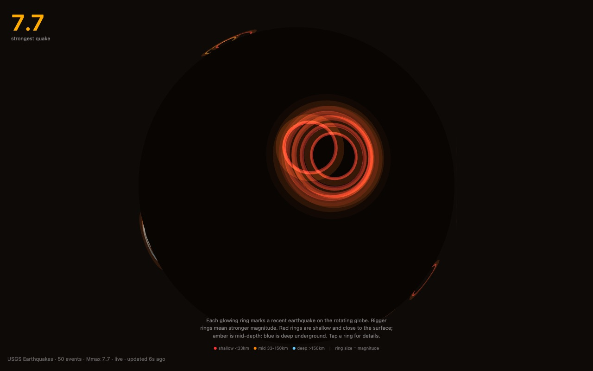

<div align="center">

<h1>tremor</h1>

<p><b>The month's biggest earthquakes, as rings on a globe.</b></p>

<p><i>Each of the fifty strongest quakes USGS has logged in the last 30 days sends a ring across a slowly turning planet.</i></p>

<h6>


</h6>

<a href="#how-it-works"><b>How it works</b></a> ·
<a href="#tap-a-ring"><b>Tap a ring</b></a> ·
<a href="#run-it"><b>Run it</b></a>

<br><br>



<sub>Local build, 22 October 2026, a few seconds after load. Real USGS data at capture time.</sub>

</div>

<br>

The page asks the [USGS Earthquake Catalog](https://earthquake.usgs.gov/fdsnws/event/1/) for
the 50 strongest events of magnitude 2.5 or more (the API's default window is the last 30 days)
and places a ring on a dark sphere at each epicentre. The rings grow outward and fade, the globe
turns, and the gold number in the corner is the largest magnitude in the batch. No API key is
needed.

## How it works

| USGS field | Drives |
|---|---|
| `mag` | Ring size (0.3 to 2.5 globe radii, scaled from M2.5 to M7) and how fast it expands |
| depth (`coordinates[2]`) | Ring colour: red under 33 km, amber 33 to 150 km, pale blue deeper than 150 km |
| latitude, longitude | Where on the sphere the ring sits, facing outward |
| strongest `mag` in the batch | The gold hero number |

The catalogue is re-fetched every 60 seconds. If the request fails, five real events from
14 July 2026 are shown instead and the stamp in the bottom-left reads `fallback` rather than
`live`. Drag to orbit and scroll to zoom. With `prefers-reduced-motion` the globe stops turning.

The globe is a plain sphere with no coastlines, so the rings are the only geography. Each ring
expands, fades out, rests for a moment and then ripples again.

## Tap a ring

Clicking a ring opens a panel with its magnitude, depth, place name, local time and a link to the
event page on USGS. It closes itself after four seconds.

## Run it

```bash
git clone https://github.com/parthchandak02/tremor.git
cd tremor
npm install
npm run dev      # local dev server
npm run build    # static site in dist/
```

The build is a plain static folder. It was written for Cloudflare Pages but is not currently
deployed anywhere.

<details>
<summary><b>Project layout</b></summary>

```
src/App.tsx                 Canvas, camera, orbit controls and the 2D overlay
src/data/earthquakes.ts     USGS fetch, 60 s polling, fallback events, zustand store
src/types.ts                Palette, magnitude and depth mappings, lat/lon to 3D
src/components/Ring.tsx     One expanding, fading ring per quake, with tap handling
src/components/QuietZone.tsx  The detail panel
brief.md                    The original creative brief
```

</details>

<br>

<div align="center">
<sub>Built with React Three Fiber, drei, zustand, TypeScript and Vite. Data from the USGS Earthquake Catalog.</sub>
</div>
